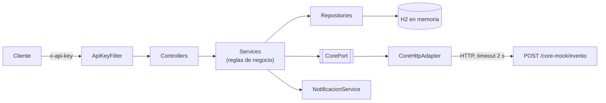

# API de Gestión de Pólizas

API REST para gestionar pólizas de arrendamiento **individuales y colectivas** y sus riesgos: listar, renovar con ajuste por IPC, cancelar, agregar y cancelar riesgos. Cada cambio de estado se informa a un CORE legado (simulado).

[](https://github.com/escobar46/Brandon_Escobar_Ocampo_Prueba_Tecnica/actions/workflows/ci.yml)

**Java 21 · Spring Boot 3.5 · Spring Data JPA · H2 · JUnit 5 · Mockito · Swagger · Docker**

> Prueba técnica — Desarrollador TI, **Módulo 2**. La especificación funcional está en [`docs/SPEC.md`](docs/SPEC.md).

---

## Revisión rápida (5 minutos)

| Paso | Comando o enlace | Qué se ve |
|---|---|---|
| 1. Levantar la API | `docker compose up --build` <br>*(o, con Java 21: `./mvnw spring-boot:run`)* | API en `http://localhost:8080` con 3 pólizas de ejemplo |
| 2. Probarla en el navegador | http://localhost:8080/swagger-ui.html → **Authorize** → `123456` | Todos los endpoints, listos para ejecutar |
| 3. Ejecutar las pruebas | `./mvnw test` | **53 pruebas** en verde |

No hace falta ejecutar nada para saber si las pruebas pasan: la insignia **CI** de arriba muestra el resultado de la última ejecución en GitHub Actions, que compila y prueba el proyecto en cada `push`.

**Archivos recomendados para leer el código:**
[`PolizaService`](src/main/java/com/brandon/polizas/service/PolizaService.java) y
[`RiesgoService`](src/main/java/com/brandon/polizas/service/RiesgoService.java) (reglas de negocio),
[`GlobalExceptionHandler`](src/main/java/com/brandon/polizas/exception/GlobalExceptionHandler.java) (errores) y
[`PolizaApiIntegrationTest`](src/test/java/com/brandon/polizas/controller/PolizaApiIntegrationTest.java) (la API probada de punta a punta).

---

## Cumplimiento del enunciado

Cada prueba lleva en su nombre el ID del caso de aceptación del [SPEC](docs/SPEC.md) (por ejemplo `CA03_renovar_poliza_cancelada_...`).

| Requerimiento | Dónde se implementa | Pruebas |
|---|---|---|
| `GET /polizas` filtrando por tipo y estado | `PolizaService.listar` | CA-14, CA-15 |
| `GET /polizas/{id}/riesgos` | `RiesgoService.listarPorPoliza` | CA-05, CA-08, CA-13 |
| `POST /polizas/{id}/renovar`: canon y prima + IPC, estado `RENOVADA` | `PolizaService.renovar` | CA-01, CA-02, CA-04 |
| `POST /polizas/{id}/cancelar` | `PolizaService.cancelar` | CA-05, CA-06 |
| `POST /polizas/{id}/riesgos`, solo si es colectiva | `RiesgoService.agregar` | CA-07, CA-08, CA-09, CA-10 |
| `POST /riesgos/{id}/cancelar` | `RiesgoService.cancelar` | CA-11, CA-12 |
| Una póliza individual solo tiene 1 riesgo | `RiesgoService.agregar` | CA-07 |
| No se puede renovar una póliza cancelada | `PolizaService.renovar` | CA-03 |
| Cancelar una póliza cancela todos sus riesgos | `PolizaService.cancelar` | CA-05 |
| Agregar un riesgo valida el tipo de póliza | `RiesgoService.agregar` | CA-07, CA-09 |
| Toda acción que modifica estado consume el servicio de edición del CORE | `CorePort` → `CoreHttpAdapter` | CA-01, CA-03, CA-11, CA-17 |
| Mock `POST /core-mock/evento` que registra en el log | `CoreMockController` | CA-18 |
| Header obligatorio `x-api-key: 123456` | `ApiKeyFilter` | CA-16 |
| Capas controller / service / repository, entidades `Poliza` y `Riesgo`, README | ver [Estructura](#estructura-del-proyecto) | — |

**Además del enunciado:** errores con un formato único, timeout hacia el CORE, aviso al tomador al renovar y cancelar,
bloqueo optimista para operaciones simultáneas, documentación Swagger, imagen Docker y Maven Wrapper (no hace falta instalar Maven).

---

## Arquitectura



**Ejemplo: qué pasa al renovar una póliza** (`POST /polizas/1/renovar`):

1. `ApiKeyFilter` valida el header `x-api-key`. Si falta o es incorrecto, responde `401` y la petición no sigue.
2. `PolizaController` recibe la petición y llama a `PolizaService.renovar(1)`.
3. El service busca la póliza (`404` si no existe) y valida la regla: si está cancelada, responde `409`.
4. Calcula `canon nuevo = canon × (1 + IPC)` redondeado a 2 decimales, `prima = canon nuevo × meses`, avanza la fecha de inicio un periodo y deja el estado en `RENOVADA`.
5. Guarda la póliza, avisa al CORE (`ACTUALIZACION`) y avisa al tomador por correo y SMS.
6. Devuelve la póliza actualizada como `PolizaResponse`.

---

## Endpoints

Todas las rutas requieren el header `x-api-key: 123456`.

| Método y ruta | Descripción | Éxito | Errores |
|---|---|---|---|
| `GET /polizas?tipo=&estado=` | Lista pólizas; filtros opcionales y combinables | 200 | 400 filtro inválido |
| `GET /polizas/{id}/riesgos` | Riesgos de una póliza | 200 | 404 |
| `POST /polizas/{id}/renovar` | Renueva: canon y prima + IPC, estado `RENOVADA` | 200 | 404 · 409 si está cancelada |
| `POST /polizas/{id}/cancelar` | Cancela la póliza y todos sus riesgos | 200 | 404 · 409 si ya está cancelada |
| `POST /polizas/{id}/riesgos` | Agrega un riesgo (solo colectivas) | 201 | 400 · 404 · 409 |
| `POST /riesgos/{id}/cancelar` | Cancela un riesgo | 200 | 404 · 409 si ya está cancelado |
| `POST /core-mock/evento` | Mock del CORE: registra el evento en el log | 202 | 400 |

Sin api key o con una incorrecta, cualquier ruta responde `401`.

<details>
<summary><b>Ejemplos con curl</b></summary>

```bash
# Listar pólizas colectivas activas
curl -H "x-api-key: 123456" "http://localhost:8080/polizas?tipo=COLECTIVA&estado=ACTIVA"

# Renovar la póliza 1 (canon 1.500.000 -> 1.575.000)
curl -X POST -H "x-api-key: 123456" http://localhost:8080/polizas/1/renovar

# Intentar renovar la póliza 3, que está cancelada -> 409
curl -X POST -H "x-api-key: 123456" http://localhost:8080/polizas/3/renovar

# Agregar un riesgo a la póliza colectiva 2 -> 201
curl -X POST -H "x-api-key: 123456" -H "Content-Type: application/json" \
  -d '{"arrendatario":"Juan Perez","direccionInmueble":"Calle 1 # 2-3"}' \
  http://localhost:8080/polizas/2/riesgos

# Cancelar el riesgo 1
curl -X POST -H "x-api-key: 123456" http://localhost:8080/riesgos/1/cancelar

# Mock del CORE
curl -X POST -H "x-api-key: 123456" -H "Content-Type: application/json" \
  -d '{"evento":"ACTUALIZACION","polizaId":555}' http://localhost:8080/core-mock/evento
```
</details>

### Datos de ejemplo

Al arrancar se cargan 3 pólizas (vigencia desde el 2026-01-01):

| id | Tipo | Estado | Canon mensual | Meses | Riesgos |
|---|---|---|---|---|---|
| 1 | INDIVIDUAL | ACTIVA | 1.500.000 | 12 | 1 |
| 2 | COLECTIVA | ACTIVA | 1.200.000 | 12 | 2 |
| 3 | COLECTIVA | CANCELADA | 900.000 | 6 | 1 (cancelado) |

### Formato de error

Todos los errores, incluido el `401`, tienen la misma forma:

```json
{ "timestamp": "2026-11-11T17:26:44Z", "status": 409, "error": "Conflict", "mensaje": "No se puede renovar una poliza cancelada" }
```

| Código | Cuándo |
|---|---|
| 400 | Body inválido (por ejemplo, falta `arrendatario`), JSON mal formado o filtro inválido |
| 401 | Falta `x-api-key` o es incorrecta |
| 404 | La póliza o el riesgo no existe |
| 409 | Se viola una regla de negocio, o dos operaciones modificaron lo mismo al mismo tiempo |

---

## Reglas de negocio

| ID | Regla |
|---|---|
| RN-01 / RN-02 | Una póliza individual tiene un solo riesgo; solo las colectivas admiten agregar riesgos |
| RN-03 | No se puede renovar una póliza cancelada |
| RN-04 | Renovar: `canon × (1 + IPC)` redondeado a 2 decimales (HALF_UP); `prima = canon × meses`; estado `RENOVADA` |
| RN-05 | Cancelar una póliza cancela todos sus riesgos |
| RN-06 / RN-07 | No se cancela dos veces lo mismo; no se agregan riesgos a una póliza cancelada |
| RN-08 / RN-09 | Toda modificación avisa al CORE; si el CORE falla o tarda más de 2 s, la operación local no se revierte y el error queda en el log |
| RN-11 | Una póliza renovada puede volver a renovarse; la fecha de inicio avanza un periodo |
| RN-12 | Si dos operaciones modifican lo mismo a la vez, la segunda recibe `409` (bloqueo optimista) |
| RN-13 | Renovar o cancelar avisa al tomador por correo y SMS (simulados en el log) |

El IPC es configurable (`polizas.ipc`, 5 % por defecto). Detalle completo y casos de aceptación en [`docs/SPEC.md`](docs/SPEC.md).

---

## Pruebas

```bash
./mvnw test
```

| Clase | Tipo | Pruebas | Qué cubre |
|---|---|---|---|
| `PolizaServiceTest` | Unitaria (Mockito) | 16 | Renovar, cancelar, listar, avisos al tomador y conflicto al guardar |
| `RiesgoServiceTest` | Unitaria (Mockito) | 9 | Agregar, cancelar y listar riesgos |
| `CoreHttpAdapterTest` | Unitaria | 2 | El CORE caído o colgado no rompe la operación (timeout) |
| `PolizaApiIntegrationTest` | Integración (MockMvc + H2) | 24 | Todos los endpoints de punta a punta: seguridad, códigos HTTP, validaciones y Swagger |
| `ConcurrenciaIntegrationTest` | Integración (H2) | 2 | Bloqueo optimista ante modificaciones simultáneas |
| **Total** | | **53** | Los 21 casos de aceptación del SPEC |

- **Unitarias:** prueban cada service aislado. El repositorio y el CORE se reemplazan por *mocks*, así cada prueba verifica una sola regla.
- **Integración:** levantan la aplicación completa con la base H2 y llaman a la API por HTTP como lo haría un cliente. En `PolizaApiIntegrationTest` cada prueba se revierte al terminar, así no se afectan entre sí; `ConcurrenciaIntegrationTest` guarda de verdad, porque el bloqueo optimista solo se comprueba al guardar.

---

## Estructura del proyecto

```
src/main/java/com/brandon/polizas
├── controller    Endpoints HTTP; delegan en los services
├── service       Reglas de negocio (PolizaService, RiesgoService) y avisos al tomador
├── repository    Acceso a datos con Spring Data JPA
├── model         Entidades Poliza y Riesgo, y sus enums
├── dto           Lo que la API recibe y devuelve (records)
├── integration   CorePort (interfaz) y CoreHttpAdapter (cliente HTTP hacia el CORE)
├── exception     Excepciones de negocio y manejo centralizado de errores
└── config        Filtro de api-key, datos de ejemplo y configuración de Swagger
```

---

## Configuración

Valores en [`application.properties`](src/main/resources/application.properties). Con Docker se cambian con variables de entorno en `docker-compose.yml`, sin recompilar.

| Propiedad | Variable de entorno | Por defecto | Uso |
|---|---|---|---|
| `polizas.api-key` | `POLIZAS_API_KEY` | `123456` | Valor esperado del header `x-api-key` |
| `polizas.ipc` | `POLIZAS_IPC` | `0.0500` | Incremento aplicado al renovar |
| `core.base-url` | `CORE_BASE_URL` | `http://localhost:8080` | URL del CORE (hoy, el mock de esta app) |
| `core.timeout` | `CORE_TIMEOUT` | `2s` | Tiempo máximo de espera al CORE |

Consola de la base de datos (solo desarrollo): http://localhost:8080/h2-console — JDBC URL `jdbc:h2:mem:polizasdb`, usuario `sa`, sin contraseña.

---

## Decisiones de diseño

| Decisión | Por qué |
|---|---|
| Capas controller → service → repository | Cada capa tiene una sola responsabilidad; las reglas de negocio viven solo en los services y se prueban sin HTTP ni base de datos |
| `CorePort` como interfaz | Los services no dependen de cómo se habla con el CORE. Pasar de HTTP a SOAP o a una cola solo cambia el adapter |
| Un fallo del CORE no revierte la operación, y la llamada tiene timeout | El CORE es un sistema externo: si cae o se demora, no debe tumbar ni bloquear la API |
| DTOs (`record`) en lugar de exponer entidades | El contrato HTTP queda separado del modelo de base de datos |
| `BigDecimal` para dinero | `double` produce errores de redondeo; el SPEC exige redondeo HALF_UP a 2 decimales |
| Errores centralizados en `GlobalExceptionHandler` | Un solo lugar define los códigos HTTP y un solo formato de error |
| `@Version` + `saveAndFlush` | Dos usuarios no pueden pisarse los cambios; el conflicto se detecta al guardar, antes de avisar al CORE o al tomador |
| IPC y api-key configurables | Cambian sin tocar el código |

## Limitaciones y siguientes pasos

Simplificaciones conscientes para el alcance de la prueba:

- **Base de datos en memoria (H2):** los datos se pierden al reiniciar. En producción: PostgreSQL u Oracle con migraciones (Flyway).
- **El aviso al CORE es directo:** si la aplicación se cae justo después de guardar, el aviso se pierde. Siguiente paso: patrón *Outbox* con reintentos.
- **Correo y SMS simulados en el log:** `NotificacionService` es el único punto que cambiaría para usar un proveedor real.
- **Seguridad mínima con api key**, como pide el enunciado. En producción: OAuth2/JWT en un API Gateway.
- **Sin creación de pólizas por API:** el enunciado no la pide; se cargan datos de ejemplo al arrancar.
